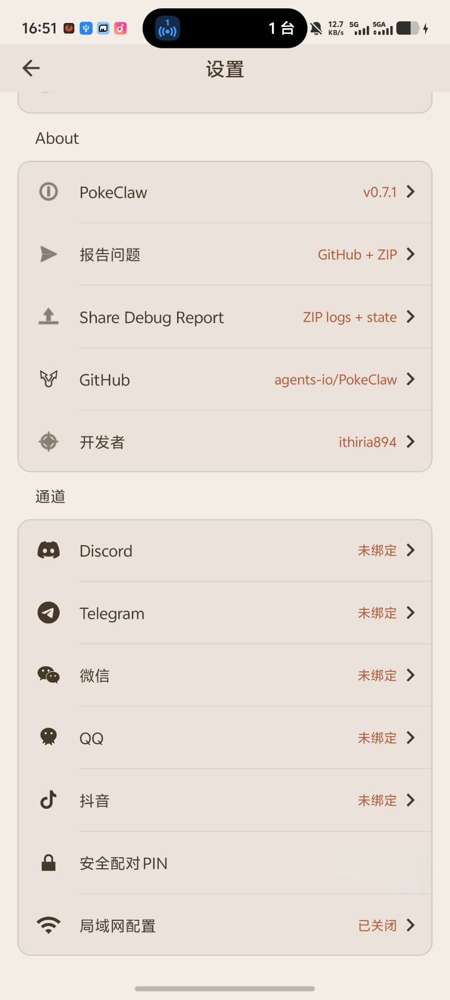
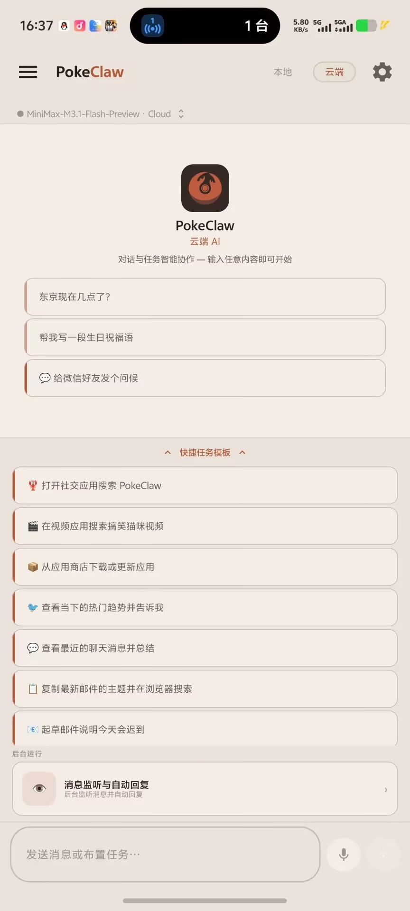
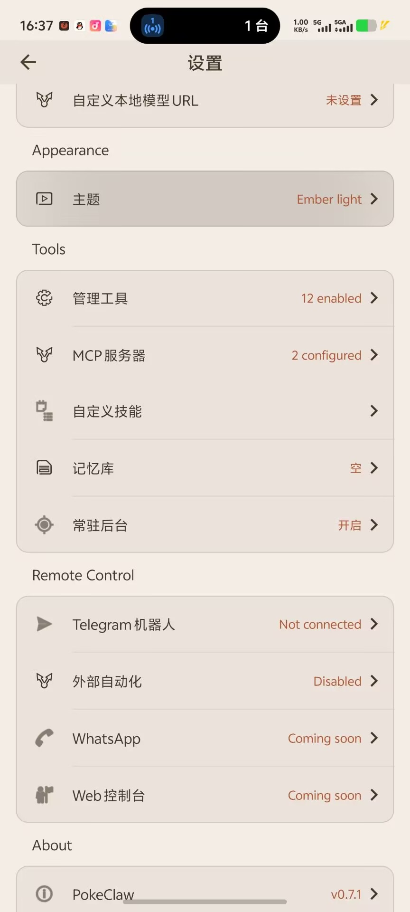

# PokeClaw Fork — 远程控制与安全加固版

> 这是 [agents-io/PokeClaw](https://github.com/agents-io/PokeClaw) 的独立 fork。上游停在 2026-06-02，本分支在其基础上继续开发，重点解决**多渠道远程控制**、**安全边界收敛**和**中文本地化**三个上游未覆盖的方向。
>
> 下方「[上游原始 README](#upstream-readme)」之后是完整的官方文档、产品定位和基准数据，内容未经改动。
>
> 🟢 活跃维护中 · 最新 **v0.8.2** · CI 全绿 · 欢迎 [issue](https://github.com/nailoooog8/PokeClaw/issues) / [PR](https://github.com/nailoooog8/PokeClaw/pulls)

[](https://github.com/agents-io/PokeClaw)
[](#)
[](https://github.com/agents-io/PokeClaw/blob/main/LICENSE)
[](https://developer.android.com)

**为什么 Android 需要一个 OEM 中立的 agent 中间层**

Google 的移动 agent 永远是 Pixel-first 的；Samsung 的 Galaxy AI 战略核心就是去 Google 化；HyperOS 的路线图写着「去 Google 化」；而中国市场 Google 根本进不来。**OEM 之间互不信任，意味着永远需要第三方的中立开源层。** 这是本 fork 存在的理由。

---

## 本 fork 相对上游做了什么

| 能力 | 说明 |
|---|---|
| **QQ 渠道** | OneBot v11 反向 WebSocket，断线自动重连 |
| **抖音渠道** | Webhook / Gateway 接入 |
| **微信渠道** | Base URL 与 Token 可配置（适配第三方网关） |
| **渠道安全网关** | 所有外部消息必须通过 PIN 配对 + 白名单，未授权发送者**无法**触达 TaskOrchestrator |
| **凭据限速锁定** | 6 位 PIN 原本零限速（10⁶ 组合可爆破），现改为失败计数 + 递增锁定 + 常量时间比较 |
| **控制台密钥脱敏** | LAN 控制台的 `GET` 接口原本明文返回全部 bot token 与 API Key，现返回掩码 |
| **MCP 客户端** | Streamable HTTP，含管理 UI、Bearer/Basic/Custom 鉴权、Keystore 落盘加密 |
| **MCP 工具投毒防护** | 第三方 MCP 服务器的描述不再原样进入 system prompt |
| **长期记忆库** | 跨会话记忆、矛盾检测、遗忘抑制指纹、访问加权保留 |
| **技能层** | YAML 配方、任务捕获、技能管理 UI |
| **任务看门狗** | 120 秒无活动 / 600 秒总时长自动中止并释放任务锁，避免卡死 |
| **后台保活** | 常驻前台服务开关 + 粘性服务 + 看门狗 |
| **三语界面** | English / 简体中文 / 日本語 |

### 安全审计

本分支做过一次完整的红队审计（OWASP MASTG / Android IPC / 间接提示注入），修复了 2 个 Critical、1 个 High、1 个 Medium：

- **Critical — PIN 暴力破解**：渠道配对 PIN 与 LAN 控制台 PIN 均为 6 位，且两处比较都**没有任何限速**。新增 `BruteForceGuard`。
- **Critical — 凭据泄漏**：`GET /api/channels` 与 `/api/llm` 明文返回全部 bot token 和 LLM API Key。读路径改为掩码返回。
- **High — MCP 工具投毒**：`McpTool` 把远程服务器的 `description` 直接拼进 system prompt，恶意服务器可向一个能点击、输入、发消息的模型注入指令。新增 `McpDescriptionSanitizer`。
- **Medium — 路径穿越**：`handleServeFile` 用 `absolutePath.startsWith(cacheDir)` 做校验，不折叠 `..`。

同时**证伪了三条假设**：SnakeYAML 反序列化（实测 2.2 版已禁用全局标签）、Debug 接收器暴露（有 `BuildConfig.DEBUG` 闸门）、记忆库召回注入（已有围栏防护）。

完整用例见 [`QA_CHECKLIST.md`](QA_CHECKLIST.md) 的 `SEC` 段（SEC1–SEC11）。

完整审计报告见 [`docs/SECURITY_AUDIT.md`](docs/SECURITY_AUDIT.md)。**该文档明确区分了「代码已修复」与「真机 E2E 已验证」**——SEC1–SEC11 目前全部尚未执行，请勿将代码修复等同于已通过安全测试。

发现新漏洞请走[私有漏洞上报](https://github.com/nailoooog8/PokeClaw/security/advisories/new)，**不要开公开 issue**——修复落地前 issue 里的细节对所有人可见。报告范围、响应预期与转上游的边界见 [`SECURITY.md`](SECURITY.md)。

---

## 界面截图

| 聊天首页 | 设置 · 通道分组 | 设置 · 工具与远程控制 |
|:---:|:---:|:---:|
|  |  |  |
| 本地 / 云端双模式，<br>中文快捷任务模板 | 本 fork 恢复可达的**通道分组**：<br>Discord / Telegram / 微信 / QQ / 抖音<br>+ 安全配对 PIN + 局域网配置 | 技能管理、MCP 服务器、<br>记忆库、常驻后台、<br>外部自动化与 Web 控制台 |

> **左图**：云端模式下接 MiniMax-M3.1-Flash-Preview 的实际对话界面，中文快捷任务模板直接可点。
>
> **中图**：这一整组入口此前被 `visibility="gone"` 隐藏——代码完整但**七个入口全部不可达**，是本 fork 修复的第一个可见问题。
>
> **右图**：工具与远程控制分组，可见 MCP 鉴权选择器与记忆库入口。

截图取自 fork 开发版真机（vivo X300 Pro BD，Android 16），拍摄于汉化补齐与版本号提升之前，因此**右图中的分组标题（`Appearance` / `Tools` / `Remote Control`）与部分状态串仍为英文**。这些已在 [v0.8.1](#changelog) 修复——重新安装 v0.8.1 后即为中文。

---

## 下载

[**下载本 fork 的 APK**](https://github.com/nailoooog8/PokeClaw/releases/latest)

| 版本 | 说明 |
|---|---|
| **v0.8.2** | 第二轮红队审计：Telegram 按 user id 授权 + 远程来源禁用高危工具 |
| v0.8.1 | 修复 fork 专属的分发问题（issue 链接、更新检查指向上游）+ 汉化补齐 |
| v0.8.0 | 首个包含安全加固与多渠道的正式版 |
| v0.7.1 | 早前的 MCP 扩展试发版，**不含**本 fork 的安全修复 |

> ⚠️ **升级说明**：v0.7.1 及更早的公开 APK 所用签名密钥已不在维护者手中。若两者签名不一致，Android 会拒绝覆盖安装，需要**先卸载旧版再安装新版本**——这会清空本地数据（本地模型缓存约 2.6 GB 需重新下载，记忆库与技能配置需重新配置）。流程与密钥约定见 [`RELEASING.md`](RELEASING.md)。

---

## 上游状态

上游 [`agents-io/PokeClaw`](https://github.com/agents-io/PokeClaw) 的 `main` 最后提交停在 **2026-06-02**，已有约 4 个月无更新。其 8 个 `feature/*` 分支中最新的停在 2026-05-26，其余均为 2026-04-13，相关改动已全部包含在本 fork 中，**无需合并**。

本 fork 独立维护，不依赖上游合并节奏。具体含义：

- **不在上游排队的 PR。** 本仓库曾向 `agents-io/PokeClaw` 提交过 [PR #80](https://github.com/agents-io/PokeClaw/pull/80)（Windows 下 `local.properties` 路径被 `Properties` 吃掉反斜杠）与 [issue #81](https://github.com/agents-io/PokeClaw/issues/81)（CLA 工作流因 `signatures/cla.json` 是空对象而失败）。截至 2026-10-14 两者均无任何回复，该仓库最老的开放 PR 已等待 161 天。**上述两个问题在本 fork 内均已修复并合入 `main`**：PR #80 的改动见 `app/build.gradle.kts` 顶部注释，issue #81 的修复见 `signatures/cla.json`。**不再等待上游处理。**
- **上游归属保持完整。** 依 [Apache-2.0 §4](https://www.apache.org/licenses/LICENSE-2.0)，本 fork 保留原 `LICENSE`、`NOTICE`（含 `Copyright 2026 agents.io`）与全部署名声明，本节即为改动说明。Apache-2.0 属宽松许可，既不要求回馈上游，也不限制本 fork 的分发方式。
- **问题反馈请提在本仓库。** App 设置页、调试报告正文、issue 链接均已改为指向本 fork（见 [Changelog v0.8.1](#changelog)）。提在上游只会进入一个已停更四个多月的队列。

---

## 快速开始

```bash
git clone -b fork/personal-fork-release https://github.com/nailoooog8/PokeClaw.git
cd PokeClaw
./gradlew assembleDebug
```

构建环境见 [`MCP_INTEGRATION_PLAN.md`](MCP_INTEGRATION_PLAN.md) 末尾的「构建环境备忘」。

**首次使用**：安装 APK → 授予无障碍权限 → 需要后台监听时再授予通知使用权 → 本地模式首次启动会下载模型（约 2.6 GB）。

> ⚠️ **vivo / 部分 OEM 注意**：强制停止应用或在部分 ROM 上重装会连带清空无障碍开关，需要手动重新打开。判断无障碍是否真的活着请看 `dumpsys accessibility` 的 `Bound services`，不要只看设置里的开关状态。

---

## 文档

| 文件 | 内容 |
|---|---|
| [`STRATEGY.md`](STRATEGY.md) | 项目定位、护城河论证、买家图谱 |
| [`EXECUTION_PLAN.md`](EXECUTION_PLAN.md) | 分阶段执行计划 |
| [`docs/ARCHITECTURE_DECISIONS.md`](docs/ARCHITECTURE_DECISIONS.md) | D1–D8 架构决策（技术尽调向） |
| [`docs/MEMORY_BANK.md`](docs/MEMORY_BANK.md) | 记忆库设计 |
| [`docs/SKILL_FORMAT.md`](docs/SKILL_FORMAT.md) | 技能配方格式 |
| [`docs/OEM_COVERAGE_TIERS.md`](docs/OEM_COVERAGE_TIERS.md) | 各 OEM 测试覆盖层级 |
| [`QA_CHECKLIST.md`](QA_CHECKLIST.md) | E2E 用例库（含安全红队段） |
| [`BACKLOG.md`](BACKLOG.md) | 功能与缺陷优先级 |

---

## 贡献与许可

本 fork 遵循上游的 **Apache-2.0** 许可，保留上游署名。原始项目作者与社区贡献者见文末 [Acknowledgments](#acknowledgments)。

---

<a name="upstream-readme"></a>

# ↑↑ 以上为本 fork 内容，以下为上游 agents-io/PokeClaw 原始 README ↑↑

---


<p align="center">
  
</p>
<p align="center">
  
</p>

<p align="center">
  <a href="https://github.com/agents-io/PokeClaw/stargazers"></a>
  <a href="https://github.com/agents-io/PokeClaw/network/members"></a>
  <a href="https://github.com/agents-io/PokeClaw/issues?q=is%3Aissue+is%3Aclosed"></a>
  
  <a href="https://github.com/agents-io/PokeClaw/releases/latest"></a>
</p>

<p align="center">
  🌐 <a href="https://agents-io.github.io/PokeClaw/">Landing Page</a> — available in English · हिन्दी · 日本語 · Deutsch · 繁中
</p>

## PokeClaw (PocketClaw) — On-Device AI Phone Agent · upstream

**PokeClaw**, also known as **PocketClaw**, is an open-source Android app for AI phone automation.

It can run Gemma 4 on-device for local, private phone control, and it also supports optional cloud models when you want stronger reasoning for harder tasks.

The current public build is a local-first prototype for turning an Android phone into an AI-operated device.

In Local mode, model execution stays inside your device. No account or API key is required for Local mode.


```
Everyone else:  Phone → Internet → Cloud API → Internet → Phone
                       💳Credit card needed, API key required. Monthly bill attached.

PokeClaw local: Phone → LLM → Phone
                       Local-first when you want it. Optional cloud when you need it.
```
**AI can control your phone, with local-first execution and optional cloud help.**

The current public build is open-source and already handles real chat, task, and automation flows on Android.

Monitor a WhatsApp contact and auto-reply:


Context-aware WhatsApp auto-reply:

https://github.com/user-attachments/assets/5a43d4d5-458a-4eea-a0a5-58d113255741

https://github.com/user-attachments/assets/5c2966c5-04e6-4b22-8d66-11915ae62096

> **☝️ Auto-reply demo:** PokeClaw monitors messages from Mom, reads what she said, and replies based on context using the on-device LLM. [Watch in higher resolution on YouTube](https://youtube.com/shorts/Vxpf474chm0)

> **☝️ Context demo:** Mom asks "what did I tell you to bring?" — the AI opens the chat, reads the full conversation on screen, sees the earlier message about wine, and replies correctly. This is the difference between context-aware and context-free replies.

https://github.com/user-attachments/assets/89999dd8-a1be-49ad-9419-60c2b38f6374


> **Why is the "hi" demo slow?** That clip was recorded on a CPU-only Android device with no usable GPU or NPU path. Running Gemma 4 E2B on pure CPU takes about 45 seconds to warm up. On stronger phones it is much faster:
> - **Google Tensor G3/G4** (Pixel 8, Pixel 9)
> - **Snapdragon 8 Gen 2/3** (Galaxy S24, OnePlus 12)
> - **Dimensity 9200/9300** (recent MediaTek flagships)
> - **Snapdragon 7+ Gen 2+** (mid-range with GPU)
>
> On these devices, warmup drops to seconds. Same model, better hardware.


## The Story

I'm building this solo. When Gemma 4 landed with native tool calling on LiteRT-LM, I wanted to know whether a phone could become a real on-device agent instead of just another chatbot. PokeClaw is the result.

The interesting part is not just chatting with a local model. The interesting part is getting a local model to read the screen, choose tools, operate apps, keep task state, and finish real phone workflows. That is exactly what this project is built for.

PokeClaw already supports fully on-device automation with Gemma 4 and optional cloud models for stronger task execution. The current focus is broader device support, more generic skills, more local model options, and a cleaner public release path.

**If you hit something interesting, [open an issue](https://github.com/agents-io/PokeClaw/issues).** Real device reports are how this gets better fast.

## Product Direction

PokeClaw is not just a chat app with a few phone-control tricks glued on top.

At its core, it is becoming a **mobile agent harness**:

- a generic tool layer for phone control
- a task/runtime loop that lets a model choose and chain those tools
- playbooks, rules, and guards that can be iterated against real device QA
- a product shell on top so the same harness is usable by normal people, not just developers

That distinction matters. The long-term goal is not to hardcode one-off app flows forever. The goal is to build the strongest practical harness for AI phone agents on Android, then ship product experiences on top of that foundation.

That is also why the project invests so heavily in:

- generic tools before narrow workflows
- repeated real-device QA instead of one-off demos
- Cloud vs Local model comparisons on the same task families
- playbooks and rules only when the model proves it needs extra structure

That direction affects how bugs are prioritized. PokeClaw should fix deterministic harness, runtime, hardware, storage, accessibility, foreground-service, signing, and QA-runner problems before drilling into one flaky model task.

Examples of harness problems worth fixing immediately:

- the model cannot observe the relevant screen text
- a tool reports success when it actually failed
- task state leaks into the next run
- Accessibility, Notification Access, foreground service, or install/update state is wrong
- model download, storage, or LiteRT startup fails before the model can run
- GPU fallback is mislabeled, crashes, or hides the real fallback reason

Examples that should usually be treated as model-performance or exploratory-agent limits unless logs prove otherwise:

- one Cloud model fails one multi-step app flow once
- one Local model cannot reason through a complex UI path
- a workflow sometimes succeeds and sometimes fails because the model chooses a weak plan
- a prompt needs repeated attempts to pick the right cross-app path

Prompts, tools, skills, and playbooks should stay generic. Add structure when it improves a reusable class of tasks; avoid one-off prompt hacks or coordinate scripts just to make a single demo pass.

### Deployment Positioning

There are already strong mobile-agent frameworks for developers, benchmarks, and cloud/desktop-controlled devices. DroidRun/Mobilerun, minitap/mobile-use, Mobile-Agent, and AppAgent-style systems are useful references, especially for planning, UI observation, benchmark design, and failure recovery. They are not the same deployment category as PokeClaw:

- DroidRun/Mobilerun local/open-source runs the agent loop in a Python CLI/container on a host machine and talks to a Portal APK through ADB/port forwarding. The Portal APK uses Android Accessibility for tree/gesture/screenshot capture, but it is not where the local LLM agent loop runs. Its phone-initiated path is cloud-backed.
- minitap/mobile-use, Mobile-Agent, AppAgent, and AppAgentX are external SDK/research harnesses that normally require Python plus ADB, UIAutomator, screenshots, Docker, cloud phones, or host-side model/API services.

PokeClaw should not try to become another PC/SDK/ADB-driven mobile automation framework. Its product lane is different:

- runs as an Android app on the user's own phone
- does not require a computer to be connected while tasks run
- uses Accessibility, Notification Access, foreground service, storage, and Android lifecycle handling inside the phone app
- runs the task loop inside the installed APK, with local LiteRT-LM or optional cloud LLMs behind the same harness
- exposes integration points for power users without making Tasker, MacroDroid, ADB, or a cloud phone fleet mandatory

External automation tools are still useful. Tasker, MacroDroid, Locale, and similar apps are good deterministic trigger engines. PokeClaw should let them trigger an AI task, but PokeClaw should remain the phone-resident execution harness.

## See the UI

👉 **[Try the interactive demo on our landing page](https://agents-io.github.io/PokeClaw/)** — click through every screen without installing anything.

## What it does

The model picks the right tool, fills in the parameters, and executes. You don't configure anything per-app. It just reads the screen and acts.

## Proven Quick Tasks

These are tasks we have already run end-to-end during on-device QA.

### Local mode

- Summarize notifications
- Explain clipboard contents
- Analyze storage / apps and suggest cleanup targets
- Check whether the battery needs charging
- Report installed apps
- Report phone temperature
- Report Bluetooth state
- Report battery, storage, and Android version
- Run quick-task cards directly from the UI and return the result in chat
- Route contact-specific send / call tasks correctly and fail cleanly when the contact does not exist on the device

### Cloud mode

- Send a WhatsApp message and auto-return to the same PokeClaw conversation
- Search inside YouTube in the real app
- Check what is trending on Twitter / X and summarize it
- Install or open Telegram from Play Store
- Open Reddit and search for `pokeclaw`
- Copy the latest email subject and Google it
- Draft an email saying you will be late
- Preserve task state and session history across cross-app execution and return

## Benchmark & Real-Device QA

Every number below comes from repeated trials on a physical Pixel 8 Pro running release builds. No cherry-picked runs, no emulators. The full verified task list and tier breakdown is in [thoughts/verified-task-capabilities.md](thoughts/verified-task-capabilities.md).

### Cloud (GPT-4.1) — 18/20 pass, real tasks on real phone

| Task | Result | Rounds | What happens |
|---|---:|---:|---|
| Search YouTube for lofi beats | ✅ | 9 | Opens YouTube, types query, hits search |
| Open Chrome and search for weather | ✅ | 9 | Opens Chrome, types query, reads results |
| Open Chrome and go to reddit.com | ✅ | 7 | URL navigation with node_id targeting |
| Compose email to test@example.com | ✅ | 12 | Opens Gmail, fills To + Subject + Body |
| Install Telegram from Play Store | ✅ | 14 | Search + tap Install + wait |
| Turn on do not disturb | ✅ | 12 | Navigates Settings, toggles DND |
| Open Settings, go to About Phone | ✅ | varies | Deep settings navigation |
| Send hi to Mom on WhatsApp | ✅ | 5 | Opens WhatsApp, finds contact, types, sends |
| Check my Instagram messages | ✅ | 5 | Handles typo ("instagarm"), opens correct app |
| 部機仲有幾多storage | ✅ | 2 | Cantonese input, returns answer in 中文 |
| 打開Instagram | ✅ | varies | Chinese command |
| Draft an email saying I'll be late | ✅ **10/10** | 8 | Repeated trials: 100% pass rate |
| Copy latest email subject and Google it | ✅ **8/10** | 15 | Gmail to Chrome cross-app flow, 80% pass rate |

All tasks use zero hardcoded app logic. The model reads the screen, picks tools, and figures out the flow on its own. Multi-language works out of the box, including Cantonese, Mandarin, and misspelled English.

### Local (Gemma 4 E2B, fully on-device) — verified on CPU and GPU

| Task family | Result | CPU avg (Pixel 8 Pro) | GPU avg (Pixel 8 Pro) | Notes |
|---|---:|---:|---:|---|
| Clipboard explain | ✅ | 2m 43s | 2m 11s | Real clipboard read |
| Notifications summary | ✅ | 2m 49s | 2m 53s | Reads live notifications and summarizes |
| Battery advice | ✅ | 2m 12s | 2m 53s | Returns level + charging state |
| Storage + apps cleanup advice | ✅ | 2m 33s | 3m 06s | Harness used to mislabel this as blocked because the answer mentioned the Contacts app |

For the current `local-core` quick-task bundle on a Pixel 8 Pro, Gemma 4 E2B passed `4/4` on both CPU and GPU. Cold-start average time was `2m 34s` on CPU versus `2m 46s` on GPU, so GPU is now **verified and usable** on this device, but it is **not yet a cold-start speed win** for this short task bundle. The value of the recent hardening work is stability and real backend verification, not inflated benchmark theater.


## How it works

PokeClaw gives a small on-device LLM a set of tools (tap, swipe, type, open app, send message, enable auto-reply, etc.) and lets it decide what to do. The LLM sees a text representation of the current screen, picks an action, sees the result, picks the next action, until the task is done.

Local execution runs via [LiteRT-LM](https://ai.google.dev/edge/litert/llm/overview) with native tool calling. In Local mode, the model runs on-device.

## Tools

The LLM has access to these tools and picks them autonomously:

| Tool | What it does |
|------|-------------|
| `tap` / `swipe` / `long_press` | Touch the screen |
| `input_text` | Type into any text field |
| `open_app` | Launch any installed app |
| `send_message` | Full messaging flow: open app, find contact, type, send |
| `auto_reply` | Monitor a contact and reply automatically using LLM |
| `get_screen_info` | Read current UI tree |
| `take_screenshot` | Capture screen |
| `finish` | Signal task completion |

These tools are generic — they work with any app, any contact, any language. The LLM picks the right tool and fills in the parameters from your request.

## Tools + Skills

Small on-device models get dramatically better when you give them a strong playbook. So we give PokeClaw reusable skills on top of generic tools.

The auto-reply feature is a good example. It doesn't work by magic — there's a predefined workflow behind it: open the chat → read all visible messages on screen → generate a context-aware reply → send it → go back to home. The model follows this recipe step by step. Every tool in that chain is generic: `open_app` works with any app, `read_screen` works on any screen, `send_message` works with any contact. The workflow just tells the model which tools to use and in what order.

This is what we're calling **Skills** — reusable workflows built from generic tools. We're actively designing a skill system inspired by [Claude Code's skill architecture](https://docs.anthropic.com/en/docs/claude-code/skills). The idea: anyone can write a skill as a simple text file that describes the steps, and the LLM follows it.

Some examples of what skills can do:

- **Auto-reply**: monitor notifications → open chat → read conversation → generate reply → send
- **Morning briefing**: open weather app → read temperature → open calendar → read today's events → open email → count unread → summarize everything
- **Smart forward**: catch a notification → open the message → read it → forward to another contact with a summary
- **Auto-booking**: open a booking app → search for a time slot → fill in details → confirm

Each skill is just a combination of the same generic tools (`open_app`, `tap`, `type`, `read_screen`, `send_message`, etc.) arranged in a specific order. The tools are the building blocks, the skills are the recipes.

Both are designed to be extensible. We're building the first 8-10 skills as built-in defaults. If the system works well, we'll open it up for the community to create and share their own tools and skills. You know your phone better than we do — you should be able to teach it new tricks.

As on-device models get smarter, more of this can become free-form. Right now, skills are how we get reliable automation out of a small local model while keeping the tool layer generic.

## Download

[**Download APK**](https://github.com/agents-io/PokeClaw/releases/latest)

> Note: If you are updating from an older public debug build and Android says the package is incompatible, uninstall the old build once and then install the latest APK fresh. Older public debug builds still receive the in-app update prompt, but they need a one-time reinstall before joining the stable-signed `0.6.x` line.

### Requirements

| | Minimum | Recommended |
|---|---|---|
| **Android** | 9+ | 12+ |
| **Architecture** | arm64 | arm64 |
| **RAM** | 8 GB | 12 GB+ |
| **Storage** | 3 GB free (model download) | 5 GB+ |
| **GPU** | Not required (CPU works) | Tensor G3/G4, Snapdragon 8 Gen 2+, Dimensity 9200+ |
| **Root** | Not required | Not required |

> ⚠️ 8 GB gets you in the door. 12 GB+ is the sweet spot for the built-in Gemma 4 local models, especially if you want smoother multitasking and faster model bring-up.

## Quick start

1. Install the APK
2. Grant Accessibility permission when prompted
3. If you want background monitor flows, also grant Notification Access
4. In Local mode, the model downloads on first local launch (~2.6 GB)
5. Switch to Chat or Task mode and start using it

Local mode needs no account and no API key. Cloud mode is optional.

## Roadmap

This is the current direction for PokeClaw based on real device testing, open issues, and the most common feature requests.

### Near-term

- **Stabler public releases and upgrades.** The release/signing path is being locked down so future public APKs upgrade cleanly instead of falling back to uninstall/reinstall behavior from the older debug-signed builds.
- **External automation input.** Tasker, MacroDroid, Locale, and similar Android automation tools are strong deterministic trigger engines. PokeClaw now exposes a production, user-enabled intent API so those tools can decide when to trigger and PokeClaw can handle the open-ended AI task execution. Next work is richer recipes, cancellation/status actions, and Tasker/MacroDroid callback-consumer QA.
- **Persistent instructions and scoped rules.** PokeClaw needs an inspectable instruction stack: hard platform/tool safety in code, user global instructions, app/channel-scoped rules, explicit user-approved memory, then the current task prompt. Screen, notification, and web content should remain untrusted context, not higher-priority instructions.
- **Missed-call auto follow-up.** A high-priority use case is: someone calls, you miss it, and PokeClaw automatically sends a follow-up message to that caller and keeps the status visible in the same chatroom. The preferred first path is SMS/API-first. WhatsApp follow-up is only worth adding if there is a reliable non-UI route; otherwise it should stay an explicit fallback path, not the core design.
- **Lower-RAM local model options.** Right now the built-in local model choices are still too heavy for a lot of mid-range phones. Smaller on-device models are high priority.
- **More small local models for real device coverage.** 1B–1.5B class models for lower-end phones are on the roadmap so more devices can at least run a usable local agent instead of being locked out by RAM limits.
- **More reliable local model downloads.** Resume/retry behavior, partial download cleanup, and corrupted-model detection are all being hardened so downloads survive weak connections and screen-off/resume cases better.
- **Broader device compatibility.** Samsung, Xiaomi, Dimensity, and low-RAM device issues are being used as real-world test cases for GPU→CPU fallback, model loading, accessibility reconnects, and generic UI control.
- **More generic phone-control skills.** We are continuing to replace brittle, app-specific assumptions with generic tools and reusable skills so tasks survive OEM UI changes better.

### In progress

- **Import your own local `.litertlm` models.** User-accessible local model import is on the roadmap so you can bring your own LiteRT model instead of being locked to the built-in download list.
- **Custom local model sources.** We want PokeClaw to go beyond a fixed built-in catalog and support user-defined model sources, including direct downloads from Hugging Face or other hosted URLs.
- **Google AI Core / system local AI integration.** We are tracking Android's newer on-device AI stack so PokeClaw can eventually use official system-level local model APIs where they make sense, instead of relying on a single runtime path forever.
- **More built-in workflows.** More quick-task / skill coverage is planned beyond the first WhatsApp-centric workflows.
- **Remote control / remote conversation flows.** Controlling a phone from another device is a real request. Telegram bot control is the first concrete path being tested; it needs clear token setup, polling status, and true end-to-end QA with an account that can start and message the bot.
- **Voice input.** A microphone button is a useful prompt input path. The first version should be explicit push-to-talk; wake-word/background listening needs a separate privacy, permission, and battery design.

### Known platform constraints

- **Edge Gallery model detection is not fully under our control.** Android hides other apps' `Android/data/...` sandboxes from normal file-pickers, so PokeClaw cannot generically "see" Edge Gallery's downloaded models unless they are exported into a user-accessible location first.
- **GPU support is runtime and device specific.** If a device can run GPU in another app but PokeClaw falls back to CPU, the next step is a debug report with device, ROM, model, selected backend, delegate init, and fallback logs. PokeClaw should keep CPU fallback safe and truthful instead of forcing GPU blindly.
- **Sideload + accessibility apps may trigger OEM security warnings.** Samsung / Play Protect warnings are being addressed through a cleaner release/signing path, but sideload trust prompts are partly controlled by the platform and OEM policy.
- **Cloud mobile-agent harnesses already exist.** PokeClaw should not compete as a cloud phone farm or desktop-controlled ADB framework. The durable product direction is a phone-resident Android harness that can run on the user's own device, slot local or cloud models, and survive real Accessibility, Notification, storage, permission, and OEM lifecycle constraints.
- **Telegram bot control requires a writable account state.** A Telegram bot cannot cold-message a user who has not started the bot, and a frozen/read-only Telegram account cannot complete the required `/start` or task-message step. Treat this as an environment blocker, not a PokeClaw channel failure.

### External Automation API

PokeClaw exposes a user-enabled Android intent entrypoint for Tasker, MacroDroid, Locale, ADB, and other trusted local automation tools.

The setting is off by default. Enable it from `Settings -> Remote Control -> External Automation`.

#### MacroDroid verified E2E

The external automation contract is designed for Tasker, MacroDroid, Locale, and similar Android automation apps. The verified end-to-end path today is MacroDroid.

Verified on a Pixel 8 Pro on 2026-04-30:

- MacroDroid macro trigger: `Shortcut Launched`
- MacroDroid action: `Send Intent`
- Intent target: `Activity`
- Intent action: `io.agents.pokeclaw.RUN_TASK`
- Package: `io.agents.pokeclaw`
- Class: `io.agents.pokeclaw.automation.ExternalAutomationActivity`
- Extra: `task = how much battery left`
- Result: MacroDroid launched PokeClaw's automation activity, PokeClaw accepted it, executed the deterministic battery tool, and returned a live battery result in the PokeClaw chatroom.

MacroDroid setup:

1. In PokeClaw, enable `Settings -> Remote Control -> External Automation`.
2. In MacroDroid, create a new macro.
3. Add any trigger you want. For a simple smoke test, use `User Input -> Shortcut Launched`.
4. Add action `Device Actions -> Send Intent`.
5. Set `Target` to `Activity`.
6. Set `Action` to `io.agents.pokeclaw.RUN_TASK`.
7. Set `Package` to `io.agents.pokeclaw`.
8. Set `Class` to `io.agents.pokeclaw.automation.ExternalAutomationActivity`.
9. Set `Extra 1` name to `task`.
10. Set `Extra 1` value to the task text, for example `how much battery left`.
11. Save the macro, then run MacroDroid's `Test macro`.

Expected result: PokeClaw opens, records the task in the chatroom, runs the task through the normal harness, and shows the result. The intent does not bypass PokeClaw safety, permissions, or tool rules.

For chat instead of task mode, use:

- Intent action: `io.agents.pokeclaw.RUN_CHAT`
- Extra name: `chat`
- Extra value: the chat message

The same pattern should work from Tasker or Locale-style tools as long as they launch the exported PokeClaw automation activity with an explicit package/class. The broadcast receiver is still available for ADB and compatible callers, but Android can block a background broadcast receiver from opening an activity on modern target SDKs.

Task example:

```bash
adb shell am broadcast \
  -a io.agents.pokeclaw.RUN_TASK \
  -p io.agents.pokeclaw \
  --es task "Summarize my notifications and tell me what is urgent"
```

Chat example:

```bash
adb shell am broadcast \
  -a io.agents.pokeclaw.RUN_CHAT \
  -p io.agents.pokeclaw \
  --es chat "What can you see on my phone right now?"
```

Supported extras:

- `task` / `task_b64`
- `chat` / `chat_b64`
- `request_id`
- `return_action`
- `return_package`

If `return_action` is provided, PokeClaw sends callback broadcasts with `status`, `request_id`, and either `result` or `error`. Current statuses are `accepted`, `completed`, `failed`, `cancelled`, `blocked`, and `rejected`. `RUN_TASK` sends `accepted` plus a terminal callback; `RUN_CHAT` currently sends only the immediate `accepted` callback.

### Where feature requests go

If you want something added, please open an issue. The roadmap above is intentionally built from real requests like:

- missed-call auto follow-up messages
- smaller local models for lower-end phones
- importing your own local models
- custom local model sources / hosted downloads
- Android AI Core / official on-device AI support
- Prompt from Intent / Tasker / MacroDroid integration
- persistent global instructions, scoped app rules, and explicit memory
- voice input and push-to-talk prompting
- Telegram bot remote control
- cleaner upgrade/install paths
- remote control from another phone
- broader distribution paths like F-Droid

## Help Wanted

PokeClaw is moving fast, and the roadmap is being shaped directly by real device reports, feature requests, and QA results. If you want to help push local phone agents forward:

- ⭐ **[Star this repo](https://github.com/agents-io/PokeClaw)** if you think local AI phone control matters
- 🐛 **[Open an issue](https://github.com/agents-io/PokeClaw/issues)** when you hit a bug or want a feature
- 🍴 **[Fork it](https://github.com/agents-io/PokeClaw/fork)** and build on it

Every star helps more people find the project. Every issue helps shape the next release.

## Changelog

### v0.8.2 (2026-10-16) — 第二轮红队审计：Telegram 身份粒度 + 高危工具闸门

完整报告见 [`docs/SECURITY_AUDIT_R2.md`](docs/SECURITY_AUDIT_R2.md)。本轮共记录 10 条发现（F1–F10），**修复了 2 条**，其余 8 条仍然开放——下面如实列出。

**F1（Critical）Telegram 白名单绑定到会话而非用户 ✅ 已修复**

配对白名单此前绑的是 `chat.id`（会话 ID）而不是 `user.id`（用户 ID）。同一个群里，任何人都能借用「与机器人私聊的那次配对」通过白名单——**加了谁，等于给那个群开了门**。同时白名单是全局的，一个渠道授权不会因为你在另一个渠道没授权而失效。现改为传 `message.from.id`，并新增 `lastFromUserId` 与 `lastChatId` 明确分离。

**F2（High）高危工具无任何人工确认闸门 ✅ 已修复（来源闸门）**

拨号、发消息、任意输入、系统按键、剪贴板、自动回复——这些工具此前**没有一层确认**，渠道消息可以直接触发。本项目没有可用的确认 UI（远程任务前台可能没有 Activity），所以做的是**来源闸门**而非弹窗：

| 任务来源 | 高危工具 | 读类工具 |
|---|---|---|
| App 内本人操作 / 会话未建立 | 允许 | 允许 |
| Telegram / Discord / 微信 / QQ / 抖音 | **拒绝** | 允许 |

未分类的工具默认按高危处理（fail-closed），新增工具不会因为「没来得及分类」而自动获得远程可达性。剪贴板的**读**侧也一并拦了——刚复制的一次性验证码同样要命。

> 这一点会改变使用习惯：**通过聊天渠道远程让手机发消息、拨号，现已不可用**。这是有意的取舍，不是缺陷。需要的话请用 App 内的 monitor 模式。

**F3–F10 未修复，如实公开**

| ID | 等级 | 问题 |
|---|---|---|
| F3 | High | 导出的自动化组件无调用方认证，且 `return_action` 造成混淆代理广播（已改为默认关闭） |
| F4 | High | `memory_recall` 返回值绕过记忆围栏，构成持久化间接注入 |
| F5 | High | LAN 控制台明文 HTTP 传输真实凭据；PIN 走 URL query |
| F6 | Medium | `SecretBox` 加密失败时静默降级为明文 |
| F7 | Medium | 用户技能 `triggers` 正则每次调用重新编译，可触发 ReDoS |
| F8 | Medium | 工具参数无条件落盘，并被打包进用户可分享的调试报告 ZIP |
| F9 | Low | `isValidHost` 对空 Host fail-open |
| F10 | Info | `WebActivity` 开启 JS 且无 scheme 白名单（当前无调用方，死代码） |

**验证**：165 个单元测试 / 23 套件 / 0 失败（新增 16 个覆盖 F1/F2）。`./gradlew testDebugUnitTest` **首次接入 CI**（此前 149 个测试零 CI 保护）。**SEC1–SEC11 真机 E2E 仍未执行**，F5 的 LAN 控制台相关验证也仍被环境阻塞（校园网 Captive Portal + Clash 劫持，需手机热点并关闭 Clash）。

### v0.8.1 (2026-10-12) — fork 自身的分发与汉化修复

v0.8.0 把安全加固和多渠道发了出去，但漏了一类**只有 fork 才存在、只有 fork 用户才会踩到**的问题。上一版是不完整的。

**Bug 报告被送错人（最要紧）**

设置页的「GitHub」菜单、「报告问题」对话框、调试报告正文里的 issue 链接，**四处全部硬编码指向上游 `agents-io/PokeClaw`**。后果是这个 fork 的用户在替 fork 提交 bug，而 issue 落进了上游作者的队列。现在统一改为构建期可配置的仓库地址，默认指向本 fork。

**更新分发通道此前是断的**

应用内更新检查同样写死了上游仓库（`UpdateChecker`）。用户装的是本 fork 的 APK，App 每天问的却是上游最新版（停在 v0.7.1，2026-05-26）——**本 fork 之后发的任何版本，他们都不会收到通知**。已改为指向本 fork，可用 `POKECLAW_UPDATE_CHECK_URL` 覆盖。

> 这两条**只存在于 fork 打包的构建中**，上游代码本身没有这个问题。

**汉化补齐**

v0.8.0 的设置页仍有大量英文。根因不是「没翻译」，而是 `SettingsActivity.kt` 里有一批英文字面量**绕过了已有的三语资源系统**。现已补齐资源键（EN / 中文 / 日本語各 +24 条）并改为资源引用：

- 分组标题：`Appearance` / `Tools` / `Remote Control` / `About`
- 状态串：`Not connected`、`Connected`、`Enabled`、`Disabled`、`Coming soon`、`Not configured`
- 计数串：`12 enabled`、`2 configured`、`空`
- 菜单项：`Share Debug Report`、`ZIP logs + state`
- 主题显示名：`Ember light` → `余烬·浅色`（仅显示名，**主题 id 未改**，它同时是存储键和 `isDark()` 的判断依据）

**验证边界**：149 个单元测试全部通过（新增 8 个覆盖版本比较与仓库地址）；**SEC1–SEC11 真机 E2E 仍未执行**。

### v0.8.0 (2026-10-12) — 首个安全加固正式版

本版本包含 5 笔改动，**是本 fork 第一个把安全修复、多渠道与中文界面一起交付的正式版本**。此前的 v0.7.1 只包含 MCP 扩展，不含以下任何一项。

**安全（红队审计修复，完整报告见 [`docs/SECURITY_AUDIT.md`](docs/SECURITY_AUDIT.md)）**

- **PIN 暴力破解（Critical）** — 渠道配对与局域网控制台的 6 位 PIN 此前零限速，10⁶ 组合可自动化穷举。现改为失败计数 + 递增锁定 + 常量时间比较（`BruteForceGuard`）。
- **凭据明文泄漏（Critical）** — 局域网控制台的 `GET /api/channels`、`GET /api/llm` 此前明文返回全部 bot token 与 LLM API Key。现读路径一律返回掩码，页面回存掩码不会清空真实值。
- **MCP 工具投毒（High）** — 第三方 MCP 服务器的工具描述此前原样进入 system prompt，等于让恶意服务器向一个会点击、会输入、会发消息的模型下达指令。现加围栏包裹并剥离伪造闭合符（`McpDescriptionSanitizer`）。
- **路径穿越（Medium）** — 调试文件接口用字符串前缀校验路径，不折叠 `..`。现两侧 canonicalize 后逐段比较。

**渠道与稳定性**

- 新增 **QQ**（OneBot v11 反向 WebSocket，断线自动重连）与**抖音**（Webhook / Gateway）渠道；微信渠道的 Base URL 与 Token 改为可配置。
- 所有外部消息必须先通过 **PIN 配对 + 白名单**，未授权发送者无法触达任务编排器。
- **任务看门狗**：120 秒无活动 / 600 秒总时长自动中止并释放任务锁，避免任务卡死。
- **渠道分组此前被 `visibility="gone"` 隐藏**，Discord / Telegram / 微信 / QQ / 抖音 / 配对 PIN / 局域网配置七个入口实际不可达。现已恢复。

**界面**

- 界面汉化并新增 **QQ / 抖音图标**；MCP 服务器新增 Bearer / Basic / 自定义鉴权选择器，凭据经 Android Keystore 加密落盘。

**升级提示**：v0.7.1 及更早版本的签名密钥已不在维护者手中，Android 可能拒绝覆盖安装。若提示签名冲突，请先卸载旧版再安装——本地模型缓存（约 2.6 GB）需重新下载。

**验证边界（请注意）**：安全修复均有单元测试覆盖（共 30 个用例），但 **SEC1–SEC11 的真机 E2E 验证尚未执行**，阻塞原因为局域网配置服务在部分 OEM 上无法从 ADB 唤起，与代码无关。详见审计报告第 4 节。

### v0.7.1 (2026-05-26) — hotfix: global prompt actually flows now

- **Fix for #45 Persistent Global Instructions** — v0.7.0 saved your global prompt to MMKV but never injected it into any LLM call. The injection helper was wired into `AgentConfig.Builder.build()` but the runtime construction path is `ResolvedModelConfig.toAgentConfig()` which uses the data class constructor directly. Verified via in-app logs: zero `PromptUtils` entries on v0.7.0 even with the prompt set. v0.7.1 also injects in `toAgentConfig` so the global prompt now reaches every cloud + local LLM call.

### v0.7.0 (2026-05-26) — feature batch

- **Voice input in chat (#44).** New mic button between the text field and the send button launches Android's built-in speech recognition; the transcript appends to whatever you already typed, so you can dictate the second half of a prompt. Works on any device with Google Speech Services; falls back gracefully with a toast on devices without it. No RECORD_AUDIO permission is requested by PokeClaw — the system dialog handles its own permission.
- **Persistent global instructions (#45).** New Settings entry under "Models" → "Global instructions". Anything you put here is prepended to every conversation's system prompt — useful for "always reply in Cantonese" or "I'm in Vancouver, default to PST" style rules. Up to 2000 characters; clear the field to disable. Applies to both chat mode and task/agent mode.
- **Custom local model download URL (#36).** Advanced Settings entry: point PokeClaw at a self-supplied `.litertlm` URL (HuggingFace mirror, your own server, etc.) and it appears as a new row in the Available Models list alongside the built-in Gemma options. File-size validation is relaxed for custom models because we can't know the expected size up front.
- **Pencil-icon rename shortcut in the sidebar.** Each saved conversation now shows a small edit icon next to its title; tap to rename without having to long-press. Long-press menu still works for delete.
- **Floating button uses the PokeClaw icon** instead of the "AI" text label.
- **Debug report includes GPU / OpenCL / RAM / ABI diagnostics** (#41 / #14). Summary now lists supported ABIs, total RAM, and whether `libOpenCL.so` is present at any of the well-known driver paths — community OEM reporters can self-diagnose GPU-path issues without a back-and-forth.
- **i18n for new features.** Voice input, global prompt, and custom model URL strings shipped in English, Simplified Chinese, and Japanese.

### v0.6.12 (2026-04-30)
- **Hotfix for Android background activity launch limits.** External automation now has an exported activity entrypoint for MacroDroid, Tasker, and Locale-style apps, avoiding Android 16 / targetSdk 36 background launch blocking when a broadcast receiver tries to open the chatroom.
- **MacroDroid setup now uses Activity target.** The verified setup launches `io.agents.pokeclaw.automation.ExternalAutomationActivity` with `RUN_TASK` / `RUN_CHAT` and the same `task` / `chat` extras.
- **Broadcast support remains available.** The broadcast receiver is still present for ADB and compatible callers, but app-based automation should prefer the Activity target on modern Android.
- **Install note for early testers.** If Android reports a package/signature conflict from an older debug or early signed APK, uninstall that old build once and then install this stable signed release.

### v0.6.11 (2026-04-30)
- **External Automation is now a production feature.** PokeClaw exposes user-enabled `RUN_TASK` and `RUN_CHAT` Android broadcast entrypoints for MacroDroid, Tasker, Locale-style automation apps, and ADB callers.
- **MacroDroid E2E is verified.** A real MacroDroid `Send Intent` macro successfully triggered PokeClaw, ran `how much battery left`, and returned the live battery result in the PokeClaw chatroom.
- **External task intents no longer wait on chat model readiness.** Task payloads now go straight through the task harness, so deterministic/direct tasks can run even on a clean install with no LLM selected.
- **Direct device-data tasks run before LLM/accessibility gates.** Requests such as battery status now use the deterministic device-data tool first instead of being blocked by missing model config when the task does not need an LLM.
- **External Automation has a safe opt-in UI.** `Settings -> Remote Control -> External Automation` is off by default and shows a confirmation before allowing trusted local automation apps to call PokeClaw.
- **Callback contract is in place.** `RUN_TASK` supports immediate `accepted` and terminal `completed` / `failed` / `cancelled` / `blocked` / `rejected` callback statuses when callers provide a return action. True callback-consumer E2E remains open for a Tasker/MacroDroid receiver profile.
- **Product direction is clearer.** The README now records the no-PC, phone-resident, local-first harness lane and distinguishes PokeClaw from PC/ADB/cloud mobile-agent frameworks.
- **Install note for early testers.** If Android reports a package/signature conflict from an older debug or early signed APK, uninstall that old build once and then install this stable signed release.

### v0.6.10 (2026-04-28)
- **Model storage hotfix for ROM-specific download failures.** PokeClaw now requires the selected model directory to be writable, not merely present, before using it for large `.litertlm` downloads.
- **External storage fallback is safer.** If the external app-files `models` directory cannot be created or written on a device/ROM, PokeClaw falls back to internal app storage instead of failing later with `ENOENT` while opening the `.downloading` file.
- **Bug reports now expose model storage state.** `Settings -> About -> Report a Bug` includes the selected, external, and internal model directories, their readable/writable/stat status, and any storage-selection error.
- **Local model logs are easier to triage.** Bug-report logcat capture now includes `LocalModelManager`, so download/storage failures carry the storage decision path.
- **Release gate is now formalized.** `QA_CHECKLIST.md` now has a per-release gate record template so future releases must explicitly record direction, harness, scope, build/test, artifact, device-smoke, distribution, and user-followup status.
- **Install note for early testers.** If Android reports a package/signature conflict from an older debug or early signed APK, uninstall that old build once and then install this stable signed release.

### v0.6.9 (2026-04-28)
- **Hotfix release for the latest user-reported task failures.** This is a focused signed release for fixes that were verified after the v0.6.8 catch-up release; the remaining exploratory QA gaps are still tracked instead of hidden.
- **WhatsApp direct send is more reliable.** Literal commands such as `send hi to Girlfriend on WhatsApp` now route straight to the direct `send_message` tool, and the focused Pixel 8 Pro regression for the wrong-chat send path now passes.
- **Direct tool execution no longer blocks the app thread.** Direct tool tasks now run off the receiver/main path, preserve their real `ToolResult`, and always clean up task state, which prevents a class of ANR-style failures during quick tasks.
- **Foreground service startup is safer on aggressive Android builds.** PokeClaw now enters foreground state immediately when the service is created if notification permission is available, reducing `ForegroundServiceDidNotStartInTimeException` crashes when a task exits early.
- **WhatsApp contact lookup avoids a false close-button match.** The contact picker no longer treats generic top-right image buttons, such as WhatsApp overflow controls, as close buttons unless the UI exposes a clear close/dismiss/cancel signal.
- **QA automation is stricter and cleaner.** The quick-task runner now cancels stale tasks between cases, dismisses stale ANR dialogs, waits for Accessibility readiness, resets foreground state, and marks `Failed:` task answers as real failures.
- **Known remaining QA gaps.** The post-fix Cloud sweep was `17 PASS / 0 FAIL / 1 BLOCKED / 2 TIMEOUT / 20 TOTAL`; WhatsApp latest-chat summary and copy-latest-email-subject-to-Google still time out, and one call task remains blocked by missing test contact data.
- **Install note for early testers.** If Android reports a package/signature conflict from an older debug or early signed APK, uninstall that old build once and then install this stable signed release.

### v0.6.8 (2026-04-28)
- **Stable public catch-up release.** This promotes the recent debug-report and local-model hardening work into a stable signed release so users can test one current APK instead of chasing debug prereleases.
- **Model download storage is more reliable.** Fixed a device-side failure where the model download directory could be missing on some ROMs, causing downloads to fail with `ENOENT` before the `.litertlm` file could even be written.
- **WhatsApp send-message is less likely to hit the wrong action.** The send-button matcher now requires either a clear send signal or a button positioned by the composer, which avoids treating top-bar call/video-call buttons as generic send candidates.
- **Contact lookup handles blocking popups better.** The contact-search flow now attempts to dismiss obvious modal overlays before searching or scrolling the chat list.
- **Foreground service coverage is stronger during tasks and monitoring.** PokeClaw now starts foreground status as soon as a task begins, and active monitor mode schedules the watchdog job so ROMs that aggressively kill services have a better recovery path.
- **Bug reports are easier to act on.** `Settings -> About -> Report a Bug` generates a ZIP with app state, filtered logcat, rolling app logs, and recent HTTP logs for device-specific model, download, accessibility, and monitor failures.
- **Release automation is cleaner.** Main-branch pushes now build debug artifacts without creating public debug prereleases, while public APK releases go through the signed tag workflow.

### v0.6.6 (2026-04-17)
- **Stable release for the post-`0.6.4` bugfix line.** This ships the fixes that were only sitting in the `0.6.5` debug prerelease, so users no longer need to test a debug cut to get them.
- **Launcher icon handling is fixed on themed / OEM launchers.** PokeClaw now ships a proper adaptive icon set, including round and monochrome resources, which fixes the mismatched icon treatment reported on Xiaomi launchers.
- **Local backend health is more truthful.** GPU paths are only treated as healthy after real runtime verification, and stale CPU-safe quarantines can re-arm a previously verified GPU path instead of leaving the device stuck on CPU forever.
- **Debug reports carry more state for triage.** Monitor and notification-listener connection state now show up in the report, which makes the unresolved device-specific local-runtime bugs easier to diagnose.
- **Legacy test coverage is back in sync.** `LocalBackendHealthTest` now matches the current crash-marker API again, so the release branch passes its backend-health unit tests instead of failing on stale constructor calls.

### v0.6.0 (2026-04-11)
- **Mainline release hardening.** Cloud and Local chat/task flows were tightened before release instead of shipping more speculative features on top.
- **Cloud task routing is less fragile.** Ordinary chat prompts like `say hi` no longer misroute into send-message behavior, while Cloud task flows still retain their multi-step capability.
- **Local chat continuity is materially better.** The on-device chat session now restores visible conversation history after session rebuilds and app relaunches, instead of silently losing the earlier turns.
- **Cloud and Local relaunch continuity are now verified.** Same-conversation memory survives a full force-stop/relaunch on both Cloud and Local paths.
- **Direct device-data tasks are more truthful.** Clipboard, notifications, battery, storage, and installed-app questions use the real device tools instead of generic chatbot refusals.
- **Models and settings are more honest.** The Models page now separates `Active model`, `Default local model`, and `Default cloud model`, and linked built-in Gemma rows no longer pretend the model is missing when the file is already usable.
- **Cloud model switching is cleaner.** Switching cloud models now emits one clear system line instead of duplicate switch messages.
- **Task/process UI is less noisy.** Normal chat no longer shows the orange `Task running...` bar, while true long-running work still shows the correct active state.
- **Local session ownership is hardened.** Chat-side local loading now stands down while a Local task owns the LiteRT session, preventing the old `session already exists` race.
- **Cloud release QA now uses success rate, not single-run theater.** The headline compose task passed `10/10`, and the Gmail-subject-to-Google exploratory task passed `8/10`, which is the right standard for stochastic Cloud flows.

### v0.5.1 (2026-04-10)
- **Chat/task input is more robust across phones.** The bottom input bar now follows the keyboard and system inset directly instead of relying on outer layout resize, which is safer across Pixel/Samsung navigation modes.
- **Public release signing is now pinned to a stable path.** GitHub releases now refuse to publish unless a stable signing key is configured, and the release workflow builds a signed `release` APK instead of accidentally shipping a debug artifact.
- **Release artifacts now include checksums.** The release pipeline also uploads `SHA256SUMS.txt` alongside the APK for easier verification.

### v0.5.0 (2026-04-10)
- **Previously shipped task flows now actually work.** Fixed stale model config reuse after switching Local/Cloud, fixed task/chat tab drift, fixed accessibility reconnect races, and fixed local task cancellation/session cleanup so tasks return to the right conversation instead of leaving stale state behind.
- **Previously broken task completions now execute the real app flow.** Explicit email-compose tasks now open a real mail composer instead of stopping with draft text in chat, and in-app search tasks can no longer fake-complete before the query is actually typed on screen.
- **Quick-task QA expanded.** Local quick tasks were swept end-to-end on-device, Cloud quick tasks now have cleaner automated coverage, and the QA runner correctly distinguishes real failures from environment blockers like permission dialogs or missing contacts.
- **Task budget default is now unlimited.** Fresh installs no longer inherit a fake default cap during development; users can still set a manual token/cost budget in Settings if they want one.
- **Previously misleading status rows now tell the truth.** Local GPU→CPU fallback now shows the real backend, the Accessibility status row reflects the real system state, and the Task Budget row shows `Unlimited` when no manual budget is set.
- **The updater now covers more real-world installs.** From v0.5.0 onward, accidental debug-build users also get the once-per-day GitHub release check, and the dialog warns when Android may require uninstalling an old debug build before installing the new APK.
- **Verified release-upgrade behavior.** Older public `0.4.0` builds do show the `v0.5.0` in-app update prompt, but upgrading from the old public debug signing path to the new public APK is a one-time uninstall + reinstall instead of an in-place replace.

<details>
<summary>Older versions (v0.1.0 — v0.4.1)</summary>

### v0.4.1 (2026-04-08)
- **Experimental task badge.** Task tab now shows `Experimental — more workflows coming soon`.
- **12 new complex task QA cases.** Added broader Cloud task coverage for YouTube search, contextual messaging, screen reading, settings toggles, app installs, web search, email compose, camera flows, typo tolerance, and ambiguous requests.

### v0.3.2 (2026-04-07)
- **Security fix.** Debug task receivers now disabled in release builds. External apps can no longer trigger tasks via broadcast.
- **Security fix.** The LAN config server was binding to all network interfaces, exposing API keys to anyone on the same WiFi. Now binds to localhost only.

### v0.3.0 (2026-04-07)
- **Cloud LLM support.** Chat and task modes now work with OpenAI, Anthropic, Google, and any OpenAI-compatible API. Switch providers with one tap in the new tabbed LLM Config screen.
- **Real-time token and cost display.** See your token count and running cost in the chat header as you talk. Color shifts from grey to blue to amber to red as usage climbs. No other mobile AI app shows you this.
- **Per-provider API keys.** Store a different API key for each provider. Switching tabs loads the right key automatically.
- **Mid-session model switch.** Start a conversation with GPT-4o, switch to Claude mid-chat, and keep your entire history. The new model picks up where the old one left off.
- **3-tier pipeline router.** Simple commands (call, alarm, open app) now execute instantly with zero LLM calls. Skill-matched tasks run deterministic step sequences. Only complex tasks hit the full agent loop.
- **8 built-in skills.** Search in App, Dismiss Popup, Scroll and Read, Send WhatsApp, Navigate to Tab, and more. Each skill saves 3-10 LLM rounds by running a hardcoded tool sequence instead of reasoning from scratch.
- **Skills UI in Task tab.** Quick Actions section shows all available skills with category icons. Tap to prefill the input bar.
- **Token budget system.** Set soft and hard limits on token usage per task. The floating pill shows live token count and cost, and you can tap to stop a runaway task.
- **Stuck detection.** Five signals detect when the agent is going in circles: repeated actions, unchanged screens, rising token count. Three-level recovery escalates from hints to strategy switches to auto-kill.
- **Enter and Tab key support.** Skills can now press Enter to submit search queries and Tab to move between form fields.

### v0.2.4 (2026-04-06)
- **Task tab redesigned with skill cards.** No more typing free-form commands that Gemma misunderstands. Two skill cards with fill-in-the-blank forms: "Monitor [name] on [WhatsApp]" and "Send [message] to [name] on [WhatsApp]".
- **Java skill routing.** Monitor and send-message tasks bypass the LLM entirely. Instant activation, zero warmup.
- **Progress bar on skill activation.** Card fills up and turns orange when active. You know exactly when monitoring starts.
- **Custom tasks disabled for on-device models.** Gemma is not smart enough to route free-form tasks to the right skill. Switch to a cloud LLM in Settings to unlock the text input.
- **Tasks stay in-app.** Starting a task no longer jumps to the home screen. You see progress in PokeClaw, then it goes to background when ready.

### v0.2.0 (2026-04-06)
- **Auto-reply now reads conversation context.** Before replying, the AI opens the chatroom and reads all visible messages on screen. It no longer forgets what was said 3 messages ago.
- **In-app update checker.** The app checks GitHub Releases once per day and prompts you to download if a newer version exists. No more manually checking.

### v0.1.0 (2026-04-06)
- Initial release. On-device Gemma 4 E2B with tool calling, accessibility-based phone control, auto-reply, task mode.

</details>

## Acknowledgments

PokeClaw exists because of [Gemma 4](https://blog.google/innovation-and-ai/technology/developers-tools/gemma-4/) by [Google DeepMind](https://github.com/google-deepmind). Thank you to [Clément Farabet](https://github.com/clementfarabet), [Olivier Lacombe](https://github.com/olivierlacombe), and the entire Gemma team for shipping an open model with native tool calling under Apache 2.0. You made it possible for a solo developer to build a working phone agent in two nights. The [LiteRT-LM](https://ai.google.dev/edge/litert/llm/overview) runtime is what makes on-device inference practical.

Also inspired by the [OpenClaw](https://github.com/openclaw/openclaw) community 🦞 for proving that AI agents that actually do things are what people want.

And thank you to [Claude Code](https://claude.ai/code) by Anthropic. I'm a CS dropout with zero Android development experience. Claude Code made it possible for me to go from nothing to a working app in two nights. The future is wild.

## Trademark

PokeClaw is a trademark of Nicole / agents.io. The name "PokeClaw" and the PokeClaw logo may not be used to endorse or promote products derived from this software without prior written permission. Forks must be renamed before distribution.

## License

Apache 2.0

Contributors sign our [CLA](CLA.md) before their first PR is merged.
